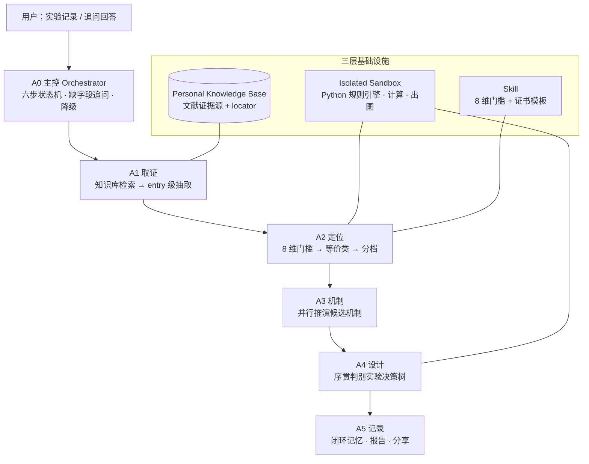

# ChemCritic

**实验没做出来之后，告诉你下一个该做哪个实验的多智能体系统。**

SciencePal AI4Science Hackathon 2026 · 赛道 4：AI Agent · 作品形态：多智能体系统

---

## 一句话

文献检索 Agent 回答"**有哪些文献**"；ChemCritic 回答"**哪两个数字可以放在一起**"。

它做三件事：

1. **定位**——你的实验结果落在哪个可比体系档里，这一档的天花板是多少（不是"正不正常"）；
2. **推演**——若低于本档水平，并行推演候选机制，每个机制带文献证据、反证与可区分性；
3. **设计**——输出一棵序贯判别实验决策树，用最少的实验排除最多的机制。

---

## 为什么需要它

同一个底物、同一个反应，文献里的"收率"可以差 60 个百分点：

| 来源 | 数值 | 口径 | 催化体系 |
|---|---|---|---|
| Miyaura 1981, *Synth. Commun.* 11, 513 | 66% / **40%** | GLC / **分离** | Pd(PPh₃)₄ / Na₂CO₃ / 苯回流 |
| Liu 2011, *Org. Biomol. Chem.* 9, 1054 | **100%** | **分离** | PdCl₂ 无配体 / K₂CO₃ / 50% EtOH-H₂O / 25 °C |
| Dewan 2018, *ACS Omega* 3, 5327 | **95%** | **分离** | 生物法 Pd NPs / K₂CO₃ / H₂O / rt |
| Chang 2015, *Dalton Trans.* 44, 17129 | 95% | ¹H NMR | Pd(OAc)₂ + SPO 配体 / NaOtBu / THF / 60 °C |
| *Molecules* 2018, 23, 2435 | 35.0 / 91.9 | GC（十六烷内标） | Pd-bpydc-La / Ce / NaOtBu / MeOH |
| Fiebor 2018, *Beilstein J. Org. Chem.* 14, 1859 | 92% | GC（校准未注明） | SNS-Pd pincer / K₃PO₄ / H₂O / 140 °C |

把这八个数字拼成"该底物收率 35%–100%"，是当前文献 Agent 最常见的输出，也是**假精确**。
在这八个报告值里，**只有 3 个构成同一等价类**（分离收率口径），其余 5 个因为口径、校准或体系不同必须隔离。

ChemCritic 的价值就是那条线：**没有通过门槛的数字，不许同框。**

> 完整文献索引（DOI、口径、归档依据、SI 缺口）见 [docs/science/LITERATURE.md](docs/science/LITERATURE.md)。

---

## 核心机制

### 8 维门槛

**硬门槛**（任一不过或 `UNKNOWN` → 禁止同框比较）

| # | 维度 | 判定要点 |
|---|---|---|
| 1 | 底物对一致 | 取代基与位置一致；芳基碘/氯、烯基/杂芳基默认排除 |
| 2 | 产物一致 | 目标产物结构一致 |
| 3 | 结果口径 `outcome_type` | isolated / GC / ¹H NMR / conversion 必须同类；**禁止换算与区间拼接** |
| 4 | Assay 与校准 | 内标种类、校准方式、以哪个底物为基准；未注明即 `UNKNOWN` |

**软门槛**（只降证据等级，不阻断，但须标注）：规模/当量/浓度、催化体系、碱/溶剂/温/时/气氛、后处理路径。

### 分档：只在档内定义"异常"

| 档 | 催化体系族 |
|---|---|
| A 经典膦配体 Pd | Pd(PPh₃)₄、Pd(OAc)₂ + 膦配体；碳酸盐或 NaOtBu；有机溶剂 |
| B 无配体 / 水相 Pd | PdCl₂ 无配体水相、生物法 Pd NPs |
| C 负载 / 多相 Pd | Pd-bpydc-Ln MOF、SNS-Pd pincer、机械化学 |

> "偏低"只能在档内成立。跨档比较只能作为**迁移目标**，不能当作"正常区间"。

### 判定结构

```json
{
  "record_id": "SM-004.entry7",
  "value": 91.9,
  "outcome_type": "GC",
  "gate_results": { "substrate": "PASS", "product": "PASS", "outcome_type": "PASS", "assay": "UNKNOWN" },
  "verdict": "BLOCKED",
  "blocking_dimension": "assay",
  "unlock_condition": "需确认是否与 SM-004 采用同一内标与校准口径",
  "peer_block": []
}
```

证书由**规则引擎**生成，LLM 只能解释、不能改写判定。

---

## 系统架构



| Agent | 职责 | SciencePal 能力 |
|---|---|---|
| **A0 主控** | 六步状态机、缺字段追问、中断与降级 | Agent Co-Building、Share |
| **A1 取证** | 文献 → entry 级结构化记录（条件/口径/locator） | Knowledge Base、Sandbox、Subagent |
| **A2 定位** | 8 维门槛、等价类、分档、异常判定 | Sandbox、Skill |
| **A3 机制** | 并行推演 3–6 个候选机制 + 证据/反证 | Subagent（≤10 并发）、Knowledge Base、Memory |
| **A4 设计** | 序贯判别实验决策树、当量与物料衡算、出图 | Sandbox（pandas / matplotlib） |
| **A5 记录** | 闭环记忆、复盘报告、分享链接 | Memory、Share Link |

---

## SciencePal 用在哪（核心环节，非装饰）

| 步骤 | 平台能力 | 移除后会发生什么 |
|---|---|---|
| 文献检索与引用 | **Personal Knowledge Base** | 证据没有 locator，整个产品失去可核验性 |
| PDF → 结构化抽取 | **Isolated Sandbox**（PyMuPDF / pdfplumber） | 抽取不可复现 |
| 8 维门槛判定 | **Isolated Sandbox**（确定性 Python） | 判定退化为 LLM 口算，不可审计 |
| 机制并行推演 | **Subagent** | 串行跑不完，证据单薄 |
| 实验设计与计算 | **Isolated Sandbox**（物料衡算、出图） | 只能给文字建议，给不出决策树 |
| 跨轮迭代 | **Memory** | 退化为一次性问答 |
| 交付与评审 | **Agent Co-Building** + **Skill** + **Share Link** | 无法复现、无法评审 |

对应赛题红线（仅用于写介绍 / 润色文案 / 制作 PPT 不构成有效使用）：**本项目七处使用全部位于判定与研究主链路。**

---

## 演示案例

**输入**

```
底物：4-溴苯甲醚 + 苯硼酸 → 4-甲氧基联苯
条件：Pd(PPh₃)₄ / THF / 60 °C / 12 h（碱、载量、当量未记录）
结果：35% 分离收率
```

**输出（节选）**

1. **分堆**：8 个报告值 → 分离类 {40%, 95%, 100%} / GC 类 {66%, 35.0%, 91.9%, 92%} / NMR 类 {95%}
2. **定位**：35% 只能进分离类；其中 40% 与你同属**档 A 经典体系**，95% / 100% 属**档 B**
3. **结论**：*"你的实验没有失败，你用的是这个底物的经典体系，它的天花板就在 40%。"*
4. **取证**：缺碱/载量/当量 → `NEEDS_EVIDENCE`，补上后可确认归档
5. **下一步**：先做物料衡算（0.5 天，区分"后处理损失 vs 反应本身差"），再决定分支

---

## 当前状态

| 模块 | 状态 |
|---|---|
| 文献核验与 entry 级记录 | ✅ **140 条参照入库**：44 条人工核验（含 42 条 A_confirmed）+ 96 条从语料层晋升（`candidate`，口径由表头/题注逐字支撑）；全部带逐字 label_raw 与 locator / locator_zh。96 条覆盖 10 个底物对，均按「底物随行变化」甄别过（范围表不入库） |
| 8 维门槛 + 三档分档 + 补证杠杆 | ✅ 已实现为确定性引擎 `chemcritic-engine/1.7.2`，自检 **29/29**、契约回归 **11/11** |
| PDF 取证端到端（抽取→审计→签核→入库→判定生效） | ✅ 已验收（见 `docs/eval/2026-10-30-PDF取证端到端验收.md`） |
| 化学感知层（RDKit 规范 SMILES 判同） | ✅ `--chemsense`；无 rdkit 自动降级，判定行为不变 |
| 六个 Agent 的平台搭建 | ✅ 平台 Agent（提示词 v8.3）+ 单文件引擎 bootstrap 已上线 |
| 评测（契约回归 + 措辞 lint + gold set） | ✅ 契约 **11 条（C1–C11）** + 措辞 lint 18 规则；gold set 扩充中 |
| 持续集成（GitHub Actions） | ✅ 每次 push / PR 自动跑 5 道门：`build_bundle --check`（产物忘了重新生成会红）· 包内自检 T1–T26 · 单文件自检 · 契约 C1–C11 · `bootstrap.sh` 端到端（无 rdkit 的降级路径）→ `.github/workflows/engine-ci.yml` |
| 语料库（候选面 → 判定层通道） | ✅ **114 篇文献 / 194 张数值数据表 / 1981 行 / 18 类反应**；其中 96 条经核验晋升进 `records.json`，其余以表级索引内嵌（`--corpus-query`，`judgeable=false`）。7 张底物范围表与 2 张阴性对照行**不入库**，理由见 `docs/plan/2026-10-31-语料层晋升.md` |
| 演示视频 / 项目说明 | 🚧 沙箱录屏待补 |

### 引擎能力一览（`chemcritic_engine.py`，单文件、零联网依赖）

| 命令 | 干什么 |
|---|---|
| `--json --input user.json` | 主判定：8 维门槛 → 分档 → 档内定位（证书含 citation/locator/逐字原文） |
| `--leverage` | 补证杠杆：补哪一条参照能解锁最多的跨口径/跨档比较（含语料级） |
| `--judge-pair ID_A ID_B` | 文献—文献两两判定：回答"这两个数能不能放进同一句话"（双向证书） |
| `--audit-table table.json` | 整表审计：逐行判同框、卡点维度、每行对库可比值 |
| `--replicates reps.json` | 重复实验统计：均值 / 样本 SD / 95% t 置信区间（内嵌 t 表，免 scipy；描述用户数据，非判定） |
| `--chemsense "名1" "名2"` | 化学感知：规范 SMILES 同一性判同 + 官能团分类（无 rdkit 自动降级） |
| `--corpus-query "底物" "反应类型"` | 检索 194 张表的语料索引：命中的表、报了多少行、收率区间、来源 DOI；`judgeable=false`，不参与判定。关键词按独立成词匹配，`iodobenzene` 不命中 `1-chloro-4-iodobenzene` |
| `--find-substrate "底物"` | 按底物**精确**盘点：条数 / 来源数 / 按来源的反应类型与区间 / 档位未定原因，并列出被排除的近名（`excluded_similar`） |
| `--list-records` | 全部参照的引用 / 定位 / 口径 / 档位 |
| `--selftest` | 28 项验收矩阵，开箱自证 |

---

## 评测方法

| 指标 | 定义 |
|---|---|
| **FPR**（假精确率） | 系统允许并列但 gold 判 BLOCKED 的对数 ÷ 允许并列的对数 |
| **FNR**（漏拒率） | 系统阻断但 gold 判 COMPARABLE 的对数 ÷ 应可并列的对数 |
| **可比类覆盖率** | 某底物的最大等价类大小 ÷ 该底物报告值总数 |

**Gold set：** 12–15 对，从 6 条已核验记录 + 34 条候选中选，人工标注 `PASS / BLOCKED + 阻断维度`。

**Baseline：** 同一批文献直接询问通用 LLM"该底物的收率范围是多少"，与其输出对照。预期 baseline 会给出跨口径的假区间。

**目标结论（可写入项目说明）：** 在本反应同一底物的 8 个报告值中，仅 3 个构成同一等价类。

---

## 仓库结构

```text
README.md
.gitignore
bootstrap.sh                    沙箱自举：装到 /workspace/chemcritic 并自检
rebuild.bat                     本地一键：打包 → 校验 → 19 项自检（push 前必跑）
agents/                         六个 Agent 的提示词（A0 主控 … A5 记录）
skills/chemcritic-comparability/
├── SKILL.md                    可比性 Skill（判定规则 + 调用契约）
└── scripts/
    ├── chemcritic_engine.py    单文件判定引擎（零依赖，沙箱可直接跑）
    └── examples/user_35pct.json
engine/                         规则引擎源码（唯一事实来源）
├── gates.py                    8 维门槛判定（确定性，LLM 无权覆盖）
├── placement.py                等价类、档内定位、双档敏感性
├── tier.py / profiles.py       分档规则与档位字段补丁表
├── schemas.py / adapter.py     数据结构与案例库适配
├── run_demo.py                 三屏演示 + T1–T18 验收矩阵
└── build_bundle.py             生成上面那个单文件版（改引擎后必须重跑）
kb/                             知识库（L2 记录、门槛、机制、检索词）
data/                           records.json（8 条已核验记录）与候选池
eval/                           gold set 与评测脚本
docs/
├── README.md                    文档索引（建议从这里开始）
├── plan/                        现行方案（唯一权威）
│   ├── 2026-10-25-ChemCritic-多智能体系统技术方案.md
│   ├── 2026-10-25-ChemCritic-角色分工与每日任务.md
│   └── 2026-10-25-方向定稿与6天执行方案.md      （背景与竞品分析）
├── integration/                 平台接入指令与验收记录
├── review/                      运行诊断与差距判定
├── science/                     科学证据
│   ├── LITERATURE.md            文献与来源索引（DOI、口径、归档结果）
│   ├── 2026-10-18-...首批5条来源记录.md
│   ├── 2026-10-18-...Suzuki文献核验.md
│   ├── 2026-10-21-...科学复核.md
│   └── Suzuki_Miyaura_文献核验报告.md
└── archive/                     已作废文档（仅留档，含作废原因）
```

**未纳入仓库：** `refs/`（PDF、候选池、解析脚本）与 `outputs/`（文献包、预览图），因体积与出版许可限制。文献 DOI 见 [docs/science/LITERATURE.md](docs/science/LITERATURE.md)。

**生成关系：** `skills/chemcritic-comparability/scripts/chemcritic_engine.py` 由 `engine/build_bundle.py` 从 `engine/*.py` + `data/records.json` 生成，**不要手改**；改完引擎跑 `python engine/build_bundle.py`，再用 `--check` 校验是否同步。平台接入步骤见 [docs/integration/2026-10-27-单文件引擎-平台接入三步.md](docs/integration/2026-10-27-单文件引擎-平台接入三步.md)。

---

## 数据与可核验性

- 全部数值来自**公开文献**，非本团队湿实验；每条记录保留 DOI、表/entry、PDF 页码与脚注原文。
- 原文未报告的字段一律记 `UNKNOWN`，**不补猜**。
- 用户自述（如"NMR 匹配"）与可审核表征证据**分字段存储**，不因自述而升级为"产物已确认"。

---

## 声明

- 本项目区分**赛前已有成果**（文献核验、候选池、科学边界文档）与**赛期新增成果**（多智能体架构、规则引擎、平台集成、评测）。
- 使用的模型、数据、代码、API 与外部工具将在提交材料中的《原创性与资源使用声明》逐项列明。
- 参考文献均为公开发表的论文，链接见 `docs/` 下的核验记录。

---

## 参考

- [SciencePal](https://sciencepal.ai/) · [Hackathon 赛题与评审](https://sciencepal.ai/hackathon)
- Miyaura, Yanagi & Suzuki, *Synth. Commun.* **1981**, 11, 513. [DOI](https://doi.org/10.1080/00397918108063618)
- Liu et al., *Org. Biomol. Chem.* **2011**, 9, 1054. [DOI](https://doi.org/10.1039/C0OB00524J)
- Chang et al., *Dalton Trans.* **2015**, 44, 17129. [DOI](https://doi.org/10.1039/C5DT02611C)
- *Molecules* **2018**, 23, 2435. [DOI](https://doi.org/10.3390/molecules23102435)
- Dewan et al., *ACS Omega* **2018**, 3, 5327. [DOI](https://doi.org/10.1021/acsomega.8b00039)
- Fiebor et al., *Beilstein J. Org. Chem.* **2018**, 14, 1859. [DOI](https://doi.org/10.3762/bjoc.14.160)
